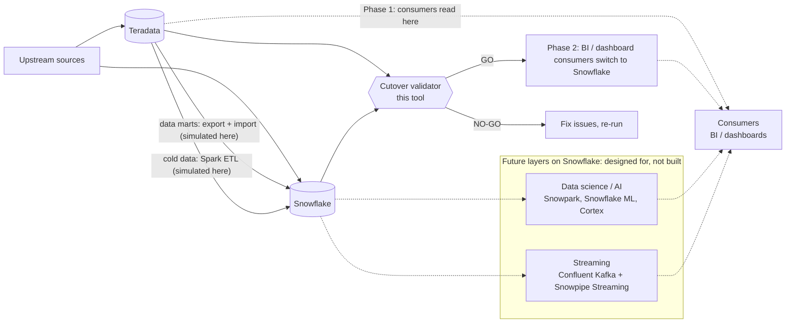

# Design

## Purpose

A command-line check that answers one question during a Teradata to Snowflake
parallel run: is it safe to switch consumers off Teradata yet? It returns GO
or NO-GO, with the reason for every blocked table.

The migration it supports runs in two phases:

- **Phase 1, parallel run.** Upstream sources feed both Teradata and
  Snowflake. Data marts are moved by export and import. Cold (historical)
  data is moved by Spark ETL. Consumers still read from Teradata.
- **Phase 2, cutover.** Consumers switch to Snowflake once the gate says GO.

In this slice, both data movements are simulated: synthetic CSV extracts are
loaded into DuckDB for both sides. The checks don't depend on how the data
was loaded.

This tool runs between the two phases. It compares what landed in Snowflake
with what is in Teradata, and decides whether Phase 2 can start.



In this repo, both databases are simulated locally (see "Why DuckDB").

## Components and data flow

```
config/tables.json
   -> DDL converter      (src/ddl_converter.py)
   -> DuckDB adapter     (src/adapters.py)
   -> reconciliation     (src/reconcile.py)
   -> gate               (src/gate.py)
   -> report and CLI     (src/cli.py)
```

| Component | What it does |
|---|---|
| `table_config.py` | Reads the table list, key columns and numeric columns from `config/tables.json`. No table names are in the code. |
| `ddl_converter.py` | Converts Teradata `CREATE TABLE` to Snowflake with sqlglot. Only known-safe types and attributes are converted. Anything else is `NEEDS_REVIEW` with no SQL, never a guess. A SET table converts with a warning, because Snowflake will not reject duplicate rows. |
| `adapters.py` | `DatabaseAdapter` interface plus `DuckDBAdapter`. Loads the source CSVs into a `source` schema and the target CSVs into a `target` schema, all columns as text, so NULL and empty string stay different. |
| `reconcile.py` | Per-table checks: column names, row count, duplicate keys in the target, sum of each numeric column (tolerance 0.005 by default), NULL and empty-string counts per column, and a row-level diff by key. Each side is queried separately; nothing joins across schemas. |
| `gate.py` | A table is ready only if its DDL is `CONVERTED` or `CONVERTED_WITH_WARNING` and every check passes. Overall GO only if every table is ready. DDL status and reconciliation are reported separately. |
| `cli.py` | Creates a run_id, logs with it, writes `reports/<run_id>.json`, prints a summary, and returns exit code 0 / 1 / 2. |
| `snowflake_check.py` | Checks converted SQL parses as Snowflake and has no Teradata-only keywords. Used by the tests and `scripts/verify.sh`. |

## Why DuckDB

The brief requires the core path to run locally from a clean checkout, with
no credentials. DuckDB is an in-process database, so it needs no server or
account. It stands in for both systems: the `source` schema plays Teradata,
the `target` schema plays Snowflake.

Reconciliation only talks to the `DatabaseAdapter` interface. A
`SnowflakeAdapter` would implement the same methods (`query`, `table_exists`,
`row_count`, `columns`) against a real warehouse. It would not load CSVs,
because the target data is already in Snowflake. Because each check queries
each side separately, the checks do not assume both sides are in one engine.
A `SnowflakeAdapter` is not implemented in this repo.

## Security and privacy

- All data in `sample-data/` is synthetic. No real customer or bank data.
- No credentials in the repo. The core path reads no environment variables.
- `.env` is in `.gitignore`. `.env.example` holds empty placeholders only.
- Reports (`reports/`) are git-ignored, because on real data they contain
  sample key values and column values from mismatched rows.

## Production shape (not built here)

- **Accounts.** Separate Snowflake dev, test and prod accounts. Validation
  logic is tested in dev and test on synthetic or masked data before it is
  run against prod.
- **Where it runs.** `scripts/verify.sh` runs in CI on every pull request.
  The validation run against real data is scheduled by the bank's existing
  orchestrator, with the table list coming from config.
- **PII.** Snowflake masking policies on sensitive columns. The validation
  role sees masked values where possible. Counts, sums and null checks still
  work on masked data; a row-level diff on masked columns compares the masked
  values, so the role design must allow that or exclude those columns.
- **Cost.** A dedicated, right-sized warehouse for validation, with
  auto-suspend, so validation runs do not compete with consumer workloads and
  their cost is visible separately.
- **Rollback.** Teradata stays live and fed until GO, and for an agreed period
  after. Rolling back means pointing consumers back to Teradata, not
  restoring data.

## CI/CD path (not built here)

1. **Build.** On every pull request, the pipeline installs pinned
   dependencies from `requirements.txt` and builds a versioned package.
2. **Verify.** The pipeline runs `scripts/verify.sh`: unit tests, the
   Snowflake syntax check, and the CLI on the sample data, which must return
   NO-GO. A change that stops catching a planted issue fails the build.
3. **Promote to dev.** On merge, the same version is deployed to a dev
   environment and run through a `SnowflakeAdapter` against a Snowflake dev
   account, so converted DDL is executed, not just parsed.
4. **Promote to test.** Run against masked copies of real tables, with
   results reviewed by the data owners for the migration wave.
5. **Promote to prod.** After an approval gate, the version is scheduled by
   the bank's orchestrator for the parallel-run tables. The GO / NO-GO report
   for each run is kept as the audit record for the cutover decision.

Secrets come from the orchestrator's or cloud provider's secret store at each
stage; nothing is stored in the repo.

## Future consumers: designed for, not built here

A bank doesn't buy Snowflake only to replace a warehouse. Data science, AI and
streaming users follow soon after cutover, so the migration should not block
them. The platform is designed for three layers sharing one governance model:

| Layer | Consumers | Snowflake capability |
|---|---|---|
| Data warehouse / BI | Dashboards, reports | Tables, views, Dynamic Tables |
| Data science / AI | Feature engineering, ML models | Snowpark (Python in Snowflake), Snowflake ML feature store, Cortex |
| Streaming | Near-real-time use cases, e.g. fraud signals | Confluent Kafka with the Snowflake Kafka connector, Snowpipe Streaming |
| Open formats | Other engines such as Spark | Apache Iceberg tables |

What this means during migration: separate warehouses per layer (so data
science workloads don't slow dashboards), sandbox schemas for data
scientists, and one set of roles, masking policies and lineage across all
layers. Each layer is built when its use case is approved.
\n